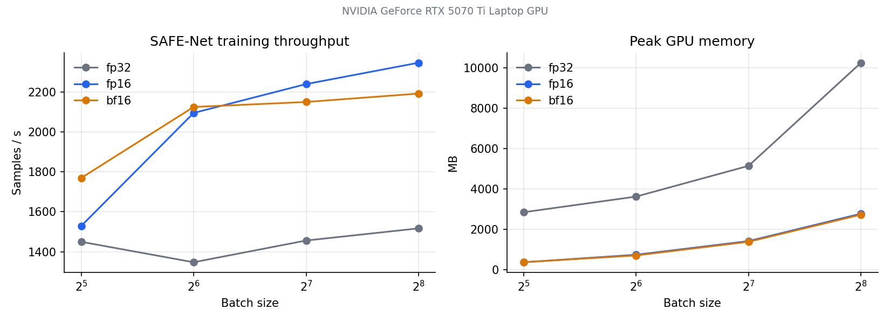
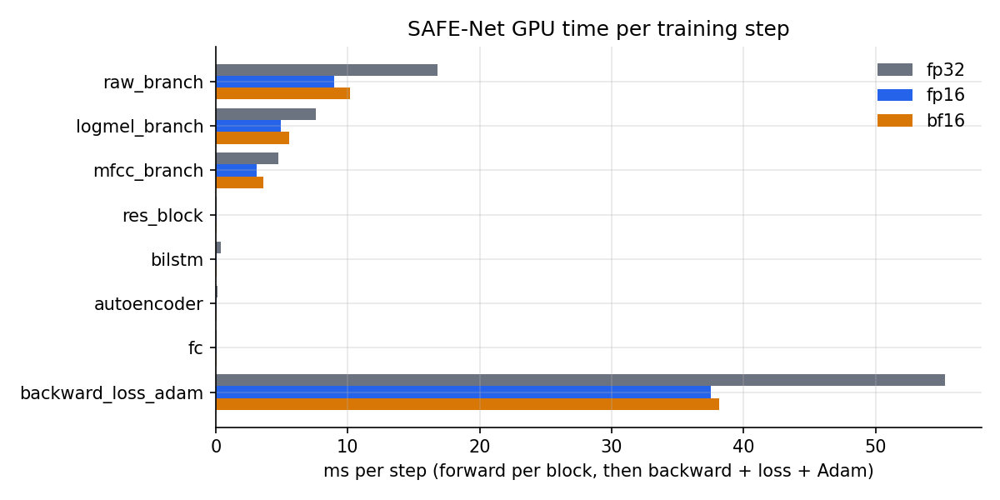
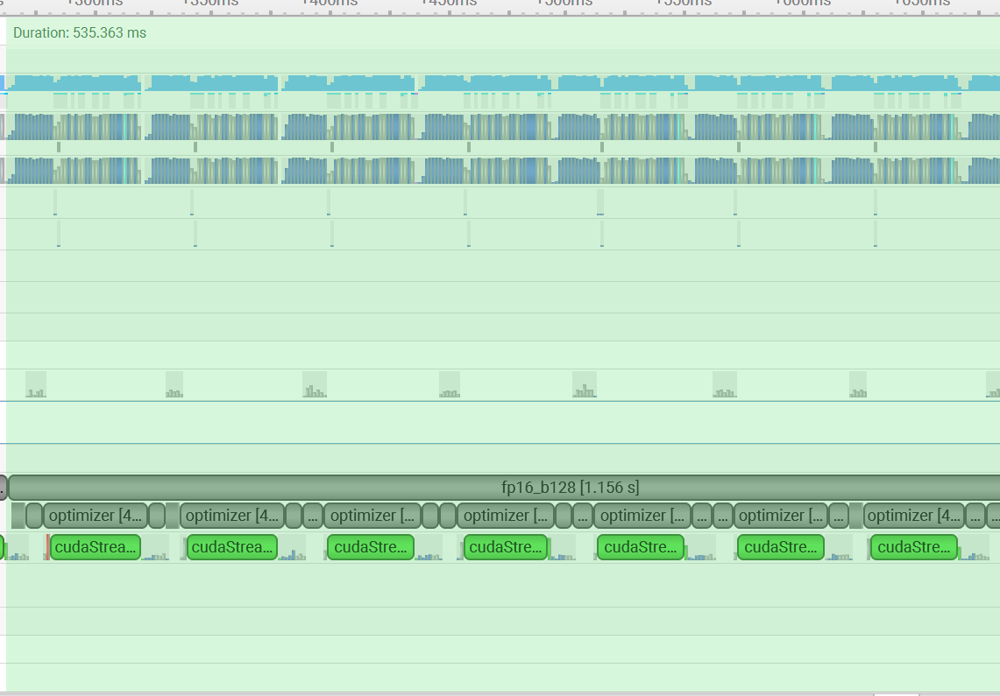
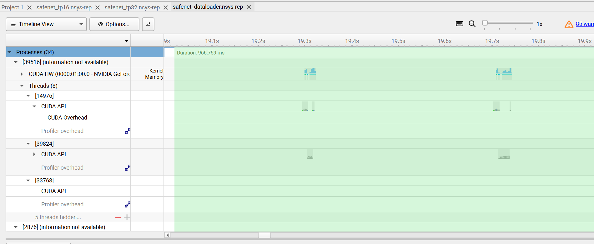
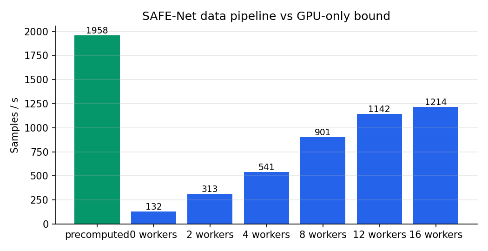
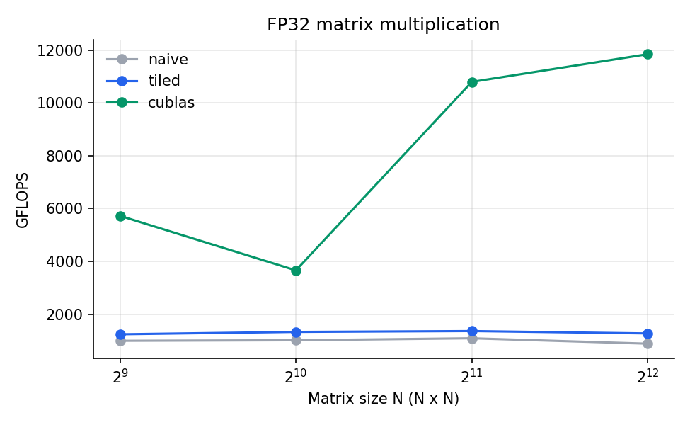
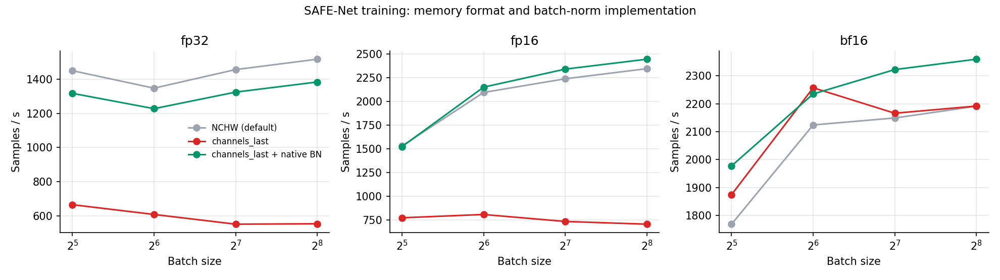

# GPU Performance Analysis of a Deep Learning Workload: SAFE-Net

Where do time and memory go when **SAFE-Net**, a multi-branch audio deepfake
detector, trains on an NVIDIA RTX 5070 Ti Laptop GPU, and what speeds it up?

SAFE-Net (1.69 M parameters, `safenet_model.py`, unchanged) takes three views of
4 s of 16 kHz audio: a raw-waveform 1D CNN, a log-mel 2D CNN and an MFCC 2D CNN,
fused through a residual block, a BiLSTM and an autoencoder branch into a
classifier. It trains on ASVspoof 2019 LA with a 9x-weighted cross-entropy loss.

## Key results

| Finding | Result |
|---|---|
| Mixed precision (FP16) vs strict FP32, batch 256 | **1.55x** training throughput, **73%** less peak memory |
| BF16 vs FP32, batch 256 | 1.44x throughput, 73% less memory |
| Where the GPU time goes | Three convolution branches: >99% of forward time; backward pass ~2/3 of each step |
| Bottleneck after AMP | Memory-bound max-pool and batch-norm backward kernels, which lower precision barely speeds up |
| SAFE-Net's original data pipeline (`NUM_WORKERS = 0`) | GPU waiting on data **95%** of the time (7% of GPU-only throughput) |
| 16 DataLoader workers | **9.2x** faster training (132 -> 1,214 samples/s) |
| Nsight Systems timeline | FP16's GradScaler forces a CPU-GPU sync every step; at 0 workers the GPU is busy <10% of the time |
| channels_last memory format (textbook fix) | Made FP32/FP16 training **~3x slower**: cuDNN batch-norm switched to NHWC kernels up to ~12x slower per call |
| channels_last + PyTorch-native BatchNorm2d | Regression removed; FP16 GPU time per step **55.5 -> 52.4 ms (-6%)**, best FP16 throughput **2,445 samples/s (1.61x FP32)** |
| Hand-written CUDA matmul | Tiled kernel peaks at **1.36 TFLOPS** (11–13% of cuBLAS), correct to 3.9e-5 |

All results: RTX 5070 Ti Laptop GPU (12 GB), GPU clock locked at 1500 MHz
(see *Test conditions*), PyTorch with CUDA 12.8+, Windows 11.

## Repository layout

| Path | What it is |
|---|---|
| `safenet_model.py` | SAFE-Net, the model under test (unchanged from the original project) |
| `common.py` | Shared helpers: synthetic batches, training step, channels_last and native batch-norm options |
| `bench.py` | Part 1 and 4: throughput and memory sweep (`--channels-last`, `--native-bn`, `--nvtx`) |
| `profile_run.py` | Part 2a and 4: PyTorch Profiler breakdown per block and per kernel |
| `dataloader_test.py` | Part 2c: DataLoader worker sweep on real ASVspoof audio |
| `matmul.cu`, `matmul_cupy.py` | Part 3: naive and tiled CUDA matmul vs cuBLAS (nvcc or CuPy) |
| `report.py` | Builds all plots and `RESULTS.md` from the CSVs |
| `check_env.py`, `run_all.ps1` | Environment check and one-shot runner (Windows) |
| `results/` | Outputs of the reference run: `RESULTS.md`, plots, Nsight screenshots, kernel summaries |

## Part 1: precision x batch size



| Batch | FP32 | FP16 | BF16 |
|---:|---:|---:|---:|
| 32 | 1,450 | 1,529 | 1,769 |
| 64 | 1,347 | 2,094 | 2,124 |
| 128 | 1,456 | 2,239 | 2,149 |
| 256 | 1,517 | **2,346** | 2,191 |

*Training samples/s. Peak memory at batch 256: FP32 10,260 MB, FP16 2,772 MB, BF16 2,725 MB.*

* **FP32 is flat from batch 32 upward.** With TF32 disabled, convolutions run
  on the regular CUDA cores, which are already saturated at batch 32; larger
  batches only cost memory.
* **FP16 and BF16 keep scaling,** because tensor cores need enough work per
  kernel to pay off: FP16 is 1.05x FP32 at batch 32 and 1.55x at batch 256.
* **At small batches BF16 beats FP16** (1.22x vs 1.05x at batch 32); FP16's
  GradScaler adds extra small kernels to every step. At large batches FP16 wins
  (see Part 2a for why).
* **Memory falls by 3.7x, not 2x.** Halving the bytes per number accounts for
  2x; the rest is consistent with cuDNN choosing FP32 convolution algorithms
  that need large scratch buffers.
* **Mixed precision does more work at less power:** about 58 W for FP16 vs
  67 W for FP32 at batch 256.

## Part 2a: where the time goes



| GPU ms per step, batch 128 | FP32 | FP16 | BF16 |
|---|---:|---:|---:|
| **Whole step** | **85.0** | **54.9** | **57.8** |
| Raw-waveform 1D CNN (forward) | 16.8 | 9.0 | 10.2 |
| Log-mel 2D CNN (forward) | 7.6 | 5.0 | 5.5 |
| MFCC 2D CNN (forward) | 4.7 | 3.1 | 3.6 |
| ResBlock + BiLSTM + autoencoder + head (forward) | 0.6 | 0.3 | 0.3 |
| Backward + loss + Adam | 55.2 | 37.5 | 38.2 |

The profiler's GPU total per step matches the benchmark's measured step time
(85.0 vs 87.9 ms in FP32), so the GPU is busy ~97% of each step: no gaps
waiting on Python.

| Rank | FP32 | FP16 | BF16 |
|---|---|---|---|
| 1 | cuDNN conv data-gradient (10.2 ms) | max-pool backward (7.3 ms) | **batch-norm backward, native kernel (11.1 ms)** |
| 2 | cuDNN conv weight-gradient (8.3 ms) | cuDNN batch-norm backward (6.4 ms) | max-pool backward (7.0 ms) |
| 3 | cuDNN batch-norm backward (7.7 ms) | NCHW->NHWC layout conversion (5.3 ms) | NCHW->NHWC layout conversion (5.5 ms) |

* **The convolution branches are the whole cost.** The residual block, BiLSTM,
  autoencoder and head together are under 1% of GPU time; the raw-waveform
  branch (a 64-tap 1D convolution over 64,000 samples) costs more than both
  spectrogram branches combined.
* **The bottleneck moves with precision.** In FP32 the top kernels are
  arithmetic-heavy convolution gradients. Tensor cores make those so fast in
  FP16/BF16 that they leave the top 3, and memory-bound kernels (max-pool and
  batch-norm backward, ~7 ms/step in every precision) take over. That is
  Amdahl's law: the parts lower precision cannot speed up cap the total gain.
* **Why BF16 trails FP16 at large batches:** FP16 batch-norm backward runs a
  cuDNN kernel (6.4 ms); BF16 falls back to PyTorch's native kernel (11.1 ms).
* **~10% of each mixed-precision step is layout conversion** (`nchwToNhwc`)
  so tensor cores get the memory layout they prefer. Keeping the 2D branches
  in `channels_last` format would remove it.

## Part 2b: timelines with Nsight Systems

`nsys profile --trace=cuda,nvtx` on `bench.py --nvtx` (batch 128, 20 steps) and
on the data-loading test. NVTX ranges mark the forward, backward and optimizer
phases of each step.




| CPU-side NVTX time per step | forward | backward | optimizer | total |
|---|---:|---:|---:|---:|
| FP16 (GradScaler on) | ~6.8 ms | ~6.7 ms | **~44 ms** | ~58 ms |
| FP32 (no GradScaler) | ~32 ms | ~50 ms | ~1.4 ms | ~83 ms |

* **NVTX ranges time the CPU, not the GPU.** GPU work is asynchronous, so a
  range ends when Python has *queued* the work, not when the GPU has done it.
* **FP16: GradScaler forces a CPU-GPU sync every step.** Before updating the
  weights, `GradScaler.step()` must check the gradients for inf/NaN, so the CPU
  blocks (`cudaStreamSynchronize` on the timeline) until the GPU finishes the
  queued forward and backward work. The 44 ms "optimizer" range is that wait,
  not Adam. The sync leaves a short GPU idle gap at every step boundary,
  visible in the kernel row. BF16 needs no GradScaler and has no sync, which
  likely contributes to BF16 beating FP16 at small batches (Part 1).
* **FP32: no sync, so the CPU runs ahead** until CUDA's launch queue fills,
  after which every launch waits for a free slot and the CPU ranges stretch to
  the GPU's pace. The kernel row is continuous; Adam itself takes ~1.4 ms.
* **First-step cost.** The very first step took ~6.6 s (FP16) and ~5.6 s (FP32)
  against ~55–90 ms steady state: with `cudnn.benchmark = True`, cuDNN times
  several algorithms per convolution shape on first use. This is why every
  benchmark here warms up before timing.
* **The backward pass runs on a separate CPU thread** (PyTorch's autograd
  engine), visible as a second thread issuing CUDA calls. This is also why
  `record_function` ranges on the main thread capture only forward work.
* **Data loading, 0 workers:** ~30 ms bursts of GPU work separated by ~380 ms
  gaps while librosa prepares the next batch: the GPU is busy under 10% of the
  time, matching the 95% data-wait measured in Part 2c.
* **Kernel summary** (`nsys stats --report cuda_gpu_kern_sum`, FP16) agrees with
  the PyTorch Profiler: `nchwToNhwc` layout conversion is the single largest
  kernel (11.3%), followed by max-pool backward (8.7%) and batch-norm backward
  (8.3%). The tensor-core convolution kernels are `sm80_xmma_*_f16f16_f16f32`
  (FP16 inputs, FP32 accumulation); they carry the Ampere (`sm80`) family name
  despite running on a Blackwell (`sm_120`) GPU.

## Part 2c: data loading



| DataLoader | Samples/s | Waiting on data | vs GPU-only |
|---|---:|---:|---:|
| Features precomputed on GPU | 1,958 | 0% | 100% |
| 0 workers (SAFE-Net's setting) | 132 | 95% | 7% |
| 4 workers | 541 | 74% | 28% |
| 8 workers | 901 | 39% | 46% |
| 12 workers | 1,142 | 1% | 58% |
| 16 workers | **1,214** | 2% | 62% |

*ASVspoof 2019 LA train FLAC files, batch 32, BF16, 24-core CPU.*

* SAFE-Net computes its log-mel and MFCC inputs with librosa inside
  `__getitem__`. With one process, the GPU spent 95% of training waiting.
* Throughput rises almost linearly to 12 workers, then plateaus. At 16
  workers the loop waits on data only 2% of the time yet reaches 62% of the
  GPU limit: the main process, which copies batches and launches hundreds of
  small kernels, is now competing with 16 workers for CPU cores.
* Next step: compute mel spectrograms and MFCCs on the GPU (`torchaudio`) so
  workers only decode audio.

## Part 3: CUDA matrix multiplication vs cuBLAS



| N | Naive | Tiled (32x32 shared memory) | cuBLAS SGEMM |
|---:|---:|---:|---:|
| 512 | 991 | 1,238 | 5,723 |
| 1024 | 1,013 | 1,328 | 3,658 |
| 2048 | 1,087 | **1,360** | 10,793 |
| 4096 | 882 | 1,270 | 11,843 |

*GFLOPS, FP32 (TF32 off). Max error vs cuBLAS at most 3.9e-5 at every size.*

* **Tiled is 1.3–1.4x naive, less than textbook.** The naive kernel's warps
  already get heavy reuse from the hardware L1/L2 caches (each warp reads the
  same row of A and contiguous columns of B). The tiled kernel then becomes
  shared-memory-bound: every fused multiply-add needs two shared-memory loads.
* **cuBLAS is ~9x faster than tiled** because each thread computes a block of
  outputs held in registers (register tiling), so each loaded value feeds many
  multiply-adds; it also uses vectorised loads, double buffering and
  per-architecture tuning.
* **Zero error at N=4096:** at that size cuBLAS most likely accumulates each
  output in the same k order as these kernels, giving bit-identical results;
  at smaller sizes it splits the k dimension differently, giving ~1e-5
  rounding differences.
* The cuBLAS dip at N=1024 is most likely timing noise on a sub-millisecond run.

## Part 4: optimisation — channels_last, a regression, and its fix

Part 2 showed ~10% of every mixed-precision step spent in cuDNN's
`nchwToNhwc` / `nhwcToNchw` kernels, which reorder tensors into the NHWC layout
tensor cores prefer. The textbook fix is to keep the 2D branches in
`channels_last` (NHWC) memory format throughout
(`model.to(memory_format=torch.channels_last)` plus channels_last inputs;
`--channels-last` in `bench.py` / `profile_run.py`).



| Training samples/s | Batch | Default (NCHW) | channels_last | channels_last + native BN |
|---|---:|---:|---:|---:|
| FP32 | 128 | 1,456 | 551 (0.38x) | 1,324 (0.91x) |
| FP16 | 128 | 2,239 | 732 (0.33x) | **2,341 (1.05x)** |
| FP16 | 256 | 2,346 | 704 (0.30x) | **2,445 (1.04x)** |
| BF16 | 128 | 2,149 | 2,166 (1.01x) | 2,322 (1.08x) |
| BF16 | 256 | 2,191 | 2,192 (1.00x) | 2,360 (1.08x) |

| GPU ms per step, batch 128 (PyTorch Profiler) | Default | channels_last | channels_last + native BN |
|---|---:|---:|---:|
| FP16: whole step | 55.5 | 164.7 | **52.4** |
| FP16: batch-norm kernels | 13.2 | **124.6** | 11.7 |
| FP16: layout conversion | 7.4 | 4.7 | 5.0 |
| FP32: whole step | 89.5 | 223.2 | 93.8 |
| FP32: batch-norm kernels | 17.1 | **141.2** | 15.1 |
| BF16: whole step | 57.2 | 51.6 | 53.5 |

**1. The fix backfired.** channels_last cut layout-conversion time by ~35%
but made FP32 and FP16 training ~3x slower. BF16 was unaffected.

**2. Diagnosis.** Both profilers pointed to the same place. With NHWC
activations, cuDNN's batch-norm switches to different kernels
(`bn_fw_tr_1C11_singleread`, `bn_bw_1C11_singleread`, an NHWC variant of
`bn_bw_1C11_kernel_new`). Batch-norm time in FP16 rose from 13 to 125 ms per
step; in Nsight Systems its share of GPU time rose from 17% to 68%, and the
slowest backward kernel went from ~2.1 ms to ~26.6 ms per call. BF16 escaped
because PyTorch already routes BF16 batch-norm to its own native kernels,
which have dedicated channels_last versions — the one difference between the
fast precision and the two slow ones.

**3. Fix.** Keep channels_last, but run each `BatchNorm2d` with cuDNN disabled
so PyTorch's native kernel is used (`--native-bn`; a 10-line wrapper,
`common.NativeBatchNorm2d`). Autograd records which implementation ran in the
forward pass, so the backward pass follows it.

**4. Result.**
* **FP16:** regression gone and a real gain: GPU time per step 55.5 -> 52.4 ms
  (-6%), training throughput +3–5% at batch 64–256. FP16 + channels_last +
  native BN is the fastest configuration measured: **2,445 samples/s, 1.61x
  the FP32 baseline**.
* **BF16:** channels_last helps directly (57.2 -> 51.6 ms GPU time per step);
  throughput gains of 0–12% across runs are within run-to-run noise, so the
  profiler's GPU time is the more reliable measure here.
* **FP32:** still ~9% slower than default. Without tensor cores, FP32 had no
  layout conversions to remove, and its NHWC convolutions are slower than its
  NCHW ones. **channels_last only pays off together with mixed precision.**
* **What remains:** 2–5 ms/step of layout conversion persists in every
  precision. It comes from the 1D raw-waveform branch, which has no
  channels_last format; rewriting its `Conv1d` layers as `Conv2d` with (1 x k)
  kernels would let it share the NHWC path.

## Test conditions

The laptop could not sustain unrestricted full-GPU load, which shaped the setup:

* **Power-protection shutdowns.** FP32 at the default boost clock (~2,640 MHz,
  ~130 W peaks) tripped the laptop's power protection within seconds
  (Windows Kernel-Power 41, no bugcheck) despite the original charger and
  active cooling. Locking the GPU clock at 1500 MHz
  (`nvidia-smi -lgc 210,1500`) cut power to ~55–75 W and removed the
  shutdowns. All results above are at 1500 MHz, so absolute throughput is
  below stock; ratios between configurations are what matter.
* **Out-of-memory crash.** FP32 at batch 1024 needed more than the 12 GB of
  VRAM; the Windows driver's sysmem fallback spilled it into system RAM over
  PCIe, and Windows crashed with DPC_WATCHDOG_VIOLATION (0x133). The sweep is
  capped at batch 256, and "CUDA Sysmem Fallback Policy" is set to
  "Prefer No Sysmem Fallback" so oversize batches fail with a clean OOM.
* **Benchmark safeguards:** 15 s rest between configurations, automatic stop
  at 87 °C, GPU temperature, power and clock logged per configuration, and
  results written after every configuration.

## Method

* **Synthetic inputs for Parts 1 and 2a** with SAFE-Net's exact shapes and a
  1:9 real:fake label mix, so only GPU work is measured. Part 2c adds the real
  data pipeline back in.
* **Training exactly as SAFE-Net trains:** Adam (lr 1e-3, wd 1e-4), weighted
  cross-entropy computed in FP32, `GradScaler` for FP16 only (BF16 has FP32's
  exponent range and needs none).
* **True FP32 baseline:** TF32 off for matmul and cuDNN; otherwise "FP32"
  would quietly use tensor cores and understate the AMP gain.
* **Correct timing:** 10 warm-up steps, `torch.cuda.synchronize()` before every
  timer read, median of 3 timed windows (spread logged, typically <5%).
* **Per-block profile:** each SAFE-Net block is wrapped in a `record_function`
  range; GPU time is the sum of kernels launched inside each range.
* **Data-loading test:** every worker warms up before timing, each worker is
  limited to one CPU thread, 100 timed batches; time blocked on
  `next(loader)` is the share of each step the GPU was starved.
* **Kernel correctness:** both CUDA kernels are checked element-wise against
  cuBLAS SGEMM in strict FP32 mode.

## Notes on SAFE-Net itself

* The BiLSTM receives `fused.unsqueeze(1)`, a sequence of length **1**, so it
  runs one LSTM step per direction: parameters and kernel launches but no
  temporal modelling. Feeding it the frame sequence from the spectrogram
  branches (before pooling) would make it model time.
* The autoencoder has no reconstruction loss of its own; it is trained only
  through the classifier, so its "reconstruction error" is not an anomaly
  score unless a reconstruction term is added to the loss.

## Limitations

* Clock-locked laptop GPU: absolute numbers are below stock; results vary
  run to run (data loading most, e.g. 12 workers measured 924 and 1,142
  samples/s in two runs).
* SAFE-Net is small (32–128-channel convolutions), so tensor cores are less
  busy than with a large CNN or transformer; AMP gains are model dependent.
* The hand-written kernels are FP32 only; cuBLAS and PyTorch AMP can use
  tensor cores, so Part 3 and Part 1 are not like-for-like.
* Nsight Systems adds tracing overhead, so its per-step times run slightly
  above the benchmark's; it is used here for structure (what waits on what),
  with throughput numbers taken from the un-traced benchmark.

## Next steps

* GPU feature extraction with `torchaudio` to remove the CPU bottleneck.
* Rewrite the raw-waveform branch's `Conv1d` layers as (1 x k) `Conv2d` so it
  can also run in channels_last and drop the remaining 2–5 ms/step of conversions.
* `torch.compile` to fuse SAFE-Net's many small kernels.
* Register-tiled matmul kernel (each thread computing a 4x4 or 8x8 block).

## Reproduce

```
conda activate dl
pip install pandas matplotlib tabulate "cupy-cuda12x[ctk]"
# admin PowerShell, if your laptop needs it:  nvidia-smi -lgc 210,1500
python bench.py
python profile_run.py --batch 128
python dataloader_test.py --data-root "<folder containing LA\>" --workers 0 2 4 8 12 16
python matmul_cupy.py          # or build matmul.cu with nvcc (see the file header)
# Nsight Systems timelines (nsys from the Nsight Systems install folder)
nsys profile -o safenet_fp16 --trace=cuda,nvtx python bench.py --precision fp16 --batch 128 --steps 20 --repeats 1 --nvtx
nsys stats --report cuda_gpu_kern_sum safenet_fp16.nsys-rep
python bench.py --channels-last                 # Part 4
python bench.py --channels-last --native-bn
python profile_run.py --batch 128 --channels-last
python profile_run.py --batch 128 --channels-last --native-bn
python report.py               # plots + RESULTS.md (written next to the scripts; results/ holds the reference run)
```
